<div align="center">
  
</div>

# DynamicBar

A Dynamic Island for Windows. A pill at the top (or bottom) of your screen that expands into media controls, notifications, a timer, quick actions and system status.

Built with Tauri 2, Rust and React 19.

## Features

- **Live activity**: media playback, volume, mic and lock-key toasts, battery and network status.
- **Notifications**: mirrors Windows notifications and keeps a history in the panel.
- **Controls**: lock, sleep, restart, shut down, screenshot, Wi-Fi, per-monitor brightness (DDC/CI for external displays, WMI for the laptop panel).
- **Timer** with presets.
- **USB drives**: arrival toast and safe eject.
- **Camera and mic in use** indicator.
- **Keep awake** and **hide from screen capture** toggles.
- **WhatsApp privacy blur**: a click-through pane over WhatsApp Desktop that shows a blurred copy of the window. Optional spotlight around the cursor. Hold `Right Ctrl` to reveal, `Ctrl+Alt+B` toggles blur, `Ctrl+Alt+S` toggles spotlight.
- **Local HTTP API** so scripts and coding agents can raise island notifications.

## Build

Requirements: Windows 10/11, [Rust](https://rustup.rs), [Bun](https://bun.sh) (or Node), WebView2.

```sh
bun install
bun run tauri dev      # development
bun run tauri build    # NSIS installer in src-tauri/target/release/bundle
cd src-tauri && cargo test
```

## Local API

Listens on `127.0.0.1:47800` only. Requests carrying an `Origin` header are refused, so a web page in your browser cannot post to it.

```sh
curl -X POST http://127.0.0.1:47800/notify -d '{"app":"build","title":"api","body":"Finished"}'
```

| Endpoint | Body |
|---|---|
| `POST /notify` | `{"app": "…", "title": "…", "body": "…"}` (`title` required) |
| `POST /claude` | Raw Claude Code hook input (`Stop`, `Notification` events) |

`integrations/omp-dynamicbar.ts` is a hook for [oh-my-pi](https://github.com/can1357/oh-my-pi) that notifies when a session finishes or needs input. Copy it to `~/.omp/agent/hooks/post/dynamicbar.ts`.

## Privacy

- Everything runs locally. Nothing is uploaded.
- The weather widget is the only network feature: it asks `ipapi.co` for an approximate location from your IP, then `open-meteo.com` for the forecast.
- The app reads Windows notifications, clipboard, media session and camera/mic usage state to show them in the island.
- The WhatsApp blur captures the WhatsApp window locally with `PrintWindow`. It is not affiliated with WhatsApp or Meta.

## License

MIT. See [LICENSE](LICENSE).
